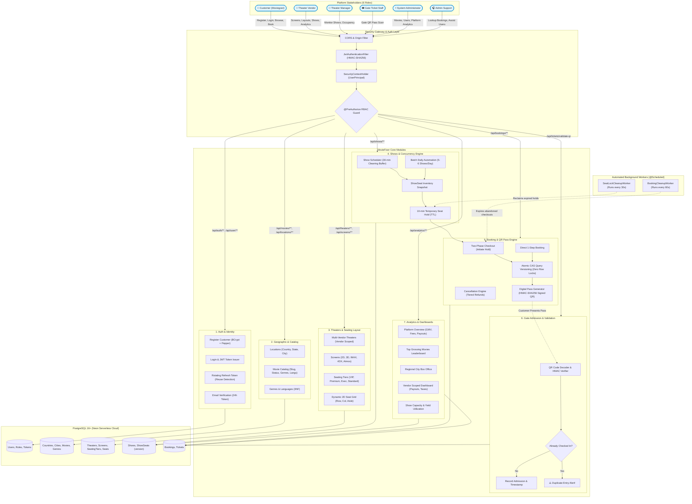
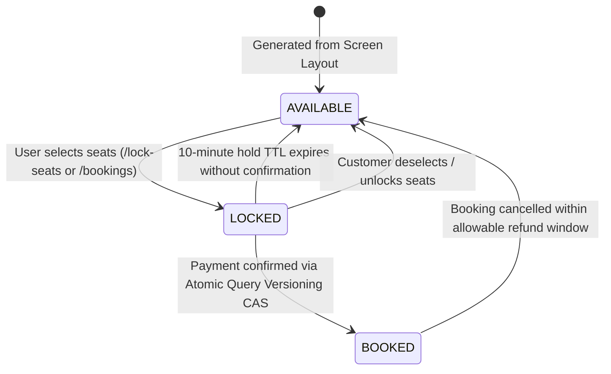
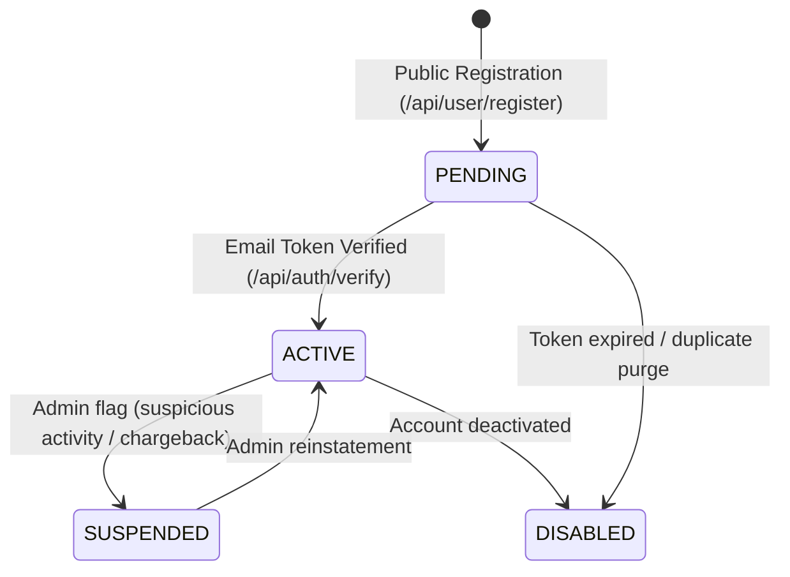
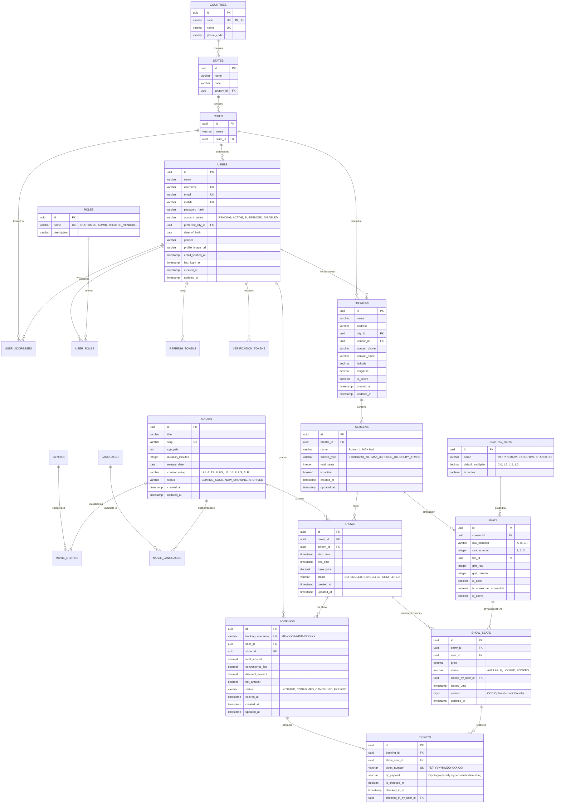

# MovieFixer – Technical Master Plan & Architecture Blueprint

> **Living Documentation**: This document serves as the authoritative single source of truth for MovieFixer's architecture, database design, role-based access control (RBAC), end-to-end workflows, API catalog, and milestone progress.

---

## 1. Project Vision & Executive Summary

**MovieFixer** is a high-throughput, multi-vendor movie ticketing marketplace platform (comparable to BookMyShow / Fandango). It connects moviegoers with cinema chains and independent theaters while guaranteeing transactional consistency, zero database row locking under extreme traffic spikes, and strict data isolation across cinema vendors.

### Core System Pillars
1. **Zero Database Row-Locking Concurrency**: Implements Optimistic Query Versioning (OCC) with atomic Compare-And-Swap (CAS) on seat inventory snapshots. Eliminates database connection pool starvation and row deadlocks.
2. **Strict Multi-Tenant Isolation**: Theater vendors and managers can only inspect and mutate auditoriums, schedules, and box-office analytics belonging to their own theater chains.
3. **Cryptographically Signed Digital QR Passes**: Admissions are secured using HMAC-SHA256 signatures, preventing fraudulent ticket forging and duplicate entry via gate validation tracking.
4. **Automated Turnaround & Daily Multi-Slot Scheduling**: Automated batch scheduler generates 5–6 daily shows per auditorium with mandatory 30-minute cleaning and turnaround collision buffers.
5. **Real-time Analytical Aggregation**: Native read-optimized SQL aggregation pipelines driving platform-wide executive metrics and vendor revenue settlement ledgers without impacting transactional throughput.

---

## 2. Stakeholder Personas & Role-Based Access Control (RBAC)

MovieFixer defines **6 first-class system roles** (`users`):

```
       ┌────────────────────────────────────────────────────────┐
       │                      System Roles                      │
       └───────────────────────────┬────────────────────────────┘
                                   │
      ┌────────────────────────────┼────────────────────────────┐
      ▼                            ▼                            ▼
  [CUSTOMER]             [THEATER_OPERATIONS]            [ADMIN_GOVERNANCE]
 (Moviegoer)             ┌─────────┴─────────┐          ┌───────┴────────┐
                         ▼         ▼         ▼          ▼                ▼
                     [VENDOR]  [MANAGER]  [STAFF]    [ADMIN]         [SUPPORT]
```

### 2.1 Role Definitions & Boundaries

1. **`CUSTOMER` (`ROLE_CUSTOMER`)**:
   - **Persona**: Individual moviegoer browsing movies and cinemas.
   - **Capabilities**: City-based discovery, interactive seat selection, temporary 10-minute seat holding, direct and two-phase checkout booking, viewing personal booking history, generating digital QR passes, and requesting cancellations according to refund policy.
   - **Boundary**: Strict self-service boundary; cannot inspect other users' bookings or mutate theater/show catalogs.

2. **`THEATER_VENDOR` (`ROLE_THEATER_VENDOR`)**:
   - **Persona**: Cinema chain owner or commercial theater operator.
   - **Capabilities**: Onboards new theaters, configures auditoriums/screens (2D, 3D, IMAX, 4DX, Dolby Atmos), designs custom 2D seating grids, schedules shows, configures dynamic pricing multipliers, and accesses vendor box office analytics.
   - **Boundary**: Scoped strictly to theaters owned by the authenticated vendor UUID. Cannot alter or view competitor theaters or platform-wide financials.

3. **`THEATER_MANAGER` (`ROLE_THEATER_MANAGER`)**:
   - **Persona**: Operational manager at a specific theater property.
   - **Capabilities**: Oversees daily show schedules, views real-time show occupancy and seating yield, coordinates ticket desk operations, and monitors gate staff scan throughput.
   - **Boundary**: Limited to operational management of assigned theater locations; cannot configure platform master data.

4. **`THEATER_TICKET_STAFF` (`ROLE_THEATER_TICKET_STAFF`)**:
   - **Persona**: Auditorium gate usher / ticket validator.
   - **Capabilities**: Scans customer digital QR passes at cinema entry points via `POST /api/tickets/validate-qr`. Reads ticket validation status and receives instant audio/visual alerts for duplicate scans.
   - **Boundary**: Dedicated read/admit validation access; cannot modify pricing, cancel shows, or access customer financial profiles.

5. **`ADMIN` (`ROLE_ADMIN`)**:
   - **Persona**: Platform executive and system administrator.
   - **Capabilities**: Full platform governance: curates global movie catalog, manages master genres and languages, creates administrative accounts with explicit roles, oversees theater vendor compliance, accesses platform-wide Gross Merchandise Value (GMV) and revenue trend analytics.
   - **Boundary**: Platform-wide master governance.

6. **`ADMIN_SUPPORT` (`ROLE_ADMIN_SUPPORT`)**:
   - **Persona**: Customer support and helpdesk representative.
   - **Capabilities**: Look up booking records by booking reference or ticket number, verify email verification status, troubleshoot customer checkout issues, and process assisted ticket cancellations.
   - **Boundary**: Read-heavy operational assistance without access to platform financial ledgers or catalog deletion privileges.

---

## 3. End-to-End Master Architecture & Workflow Flowchart



---

## 4. Lifecycle State Machines

### 4.1 Show Seat Inventory Lifecycle (`ShowSeatStatus`)



### 4.2 Booking Session Lifecycle (`BookingStatus`)

```mermaid
stateDiagram-v2
    [*] --> INITIATED : Customer holds seats and initiates checkout session
    INITIATED --> CONFIRMED : Payment verified; Tickets & QR passes generated
    INITIATED --> EXPIRED : 10-minute checkout window elapses
    CONFIRMED --> CANCELLED : Customer cancels booking (Tiered refund applied)
    EXPIRED --> [*]
    CANCELLED --> [*]
    CONFIRMED --> [*]
```



### 4.3 User Account Lifecycle (`AccountStatus`)



---

## 5. Technology Stack & Framework Specifications

| Tier | Technology | Version | Purpose & Rationale |
| :--- | :--- | :--- | :--- |
| **Language** | Java | **25** | High-performance runtime, virtual threads, pattern matching |
| **Framework** | Spring Boot | **4.0.8** | Modern modular enterprise REST framework |
| **Persistence** | Spring Data JPA / Hibernate | **7.2.24** | Automated schema management, 3NF ORM |
| **Database** | PostgreSQL | **16+** | Neon Serverless PostgreSQL with SSL connection pooling |
| **Primary Keys** | UUIDv7 (RFC 9562) | Native | 48-bit Unix timestamp prefix for sequential B-Tree index inserts |
| **Security** | Spring Security | **6.x** | Stateless filter chain, method-level RBAC (`@PreAuthorize`) |
| **JWT** | JJWT (`io.jsonwebtoken`) | **0.12.6** | HMAC-SHA256 signed access tokens + rotating DB refresh tokens |
| **Password Security**| Dual-Layer Peppered BCrypt| Cost 12 | Dynamic per-hash salt + application secret pepper |
| **Documentation** | Springdoc OpenAPI | **3.0** | Interactive Swagger specification at `/swagger-ui/index.html` |
| **Build System** | Apache Maven Wrapper | **3.9.9** | Hermetic, reproducible builds across environments |

---

## 6. Complete Feature-Based Package Architecture

The codebase strictly enforces the **Package-by-Feature** architectural pattern under `com.moviebooking`:

```text
com.moviefixer
│
├── MovieFixer.java                              # Spring Boot Application Entry Point
│
├── common/                                      # [CROSS-CUTTING PLATFORM FOUNDATIONS]
│   ├── config/
│   │   ├── SecurityConfig.java                  # SecurityFilterChain, CORS, Stateless filter
│   │   ├── PepperedPasswordEncoder.java         # Dual-layer BCrypt (Cost 12) + Secret Pepper
│   │   └── OpenApiConfig.java                   # Swagger OpenAPI 3.0 configuration
│   ├── dto/
│   │   ├── ApiResponse.java                     # Standard response envelope (success, created, error)
│   │   └── ErrorResponse.java                   # RFC 7807 problem details error model
│   ├── exception/
│   │   ├── ResourceNotFoundException.java       # HTTP 404 entity lookup failure
│   │   └── GlobalExceptionHandler.java          # Global REST advice (Spring Security, validation, conflicts)
│   └── initializer/
│       └── DatabaseSeeder.java                  # Auto-seeds 6 roles, metro cities, genres, languages, tiers
│
├── location/                                    # [DOMAIN: GEOGRAPHIC REFERENCE DATA]
│   ├── entity/                                  # Country, State, City (3NF normalized)
│   ├── repository/                              # CountryRepository, StateRepository, CityRepository
│   ├── dto/                                     # CitySummaryResponse
│   ├── service/                                 # LocationService, LocationServiceImpl
│   └── controller/                              # LocationController (GET /api/locations/**)
│
├── usermanagement/                              # [DOMAIN: USER IDENTITY & REGISTRATION]
│   ├── entity/                                  # Users, Role, UserAddress
│   ├── enums/                                   # AccountStatus, Gender, USER_ROLE, AddressType
│   ├── repository/                              # UserRepository, RoleRepository, UserAddressRepository
│   ├── dto/                                     # RegisterUserRequest, CreateUserRequest, UserResponse
│   ├── exception/                               # UserAlreadyExistsException (HTTP 409)
│   ├── service/                                 # UserService, UserServiceImpl
│   └── controller/                              # CreateUserController (/api/user/register, /create, /me)
│
├── auth/                                        # [DOMAIN: AUTHENTICATION & JWT TOKENS]
│   ├── entity/                                  # RefreshToken, VerificationToken
│   ├── repository/                              # RefreshTokenRepository, VerificationTokenRepository
│   ├── dto/                                     # LoginRequest, RefreshTokenRequest, VerifyEmailRequest, AuthResponse
│   ├── exception/                               # AccountNotVerifiedException, InvalidTokenException
│   ├── security/                                # JwtTokenProvider, JwtAuthenticationFilter, UserPrincipal, CustomUserDetailsService
│   ├── service/                                 # AuthService, AuthServiceImpl
│   ├── listener/                                # UserRegistrationEventListener (auto-generates verification token)
│   └── controller/                              # AuthController (/api/auth/login, /refresh, /logout, /verify)
│
├── movie/                                       # [DOMAIN: MOVIE CATALOG & METADATA]
│   ├── entity/                                  # Movie, Genre, Language
│   ├── enums/                                   # ContentRating, MovieStatus
│   ├── repository/                              # MovieRepository, GenreRepository, LanguageRepository
│   ├── dto/                                     # CreateMovieRequest, UpdateMovieRequest, MovieResponse, MovieSummaryResponse
│   ├── service/                                 # MovieService, MovieServiceImpl, GenreService, LanguageService
│   └── controller/                              # MovieController, GenreController, LanguageController (/api/movies/**)
│
├── theater/                                     # [DOMAIN: THEATERS, AUDITORIUMS & SEATING]
│   ├── entity/                                  # Theater, Screen, SeatingTier, Seat
│   ├── enums/                                   # ScreenType, TierType
│   ├── repository/                              # TheaterRepository, ScreenRepository, SeatingTierRepository, SeatRepository
│   ├── dto/                                     # CreateTheaterRequest, CreateScreenRequest, BatchSeatLayoutRequest, GenerateGridRequest
│   ├── service/                                 # TheaterService, ScreenService, SeatingTierService, SeatLayoutService
│   └── controller/                              # TheaterController, ScreenController, SeatingTierController (/api/theaters/**)
│
├── show/                                        # [DOMAIN: SHOW SCHEDULES & OCC INVENTORY]
│   ├── entity/                                  # Show, ShowSeat
│   ├── enums/                                   # ShowStatus, ShowSeatStatus
│   ├── repository/                              # ShowRepository, ShowSeatRepository
│   ├── dto/                                     # CreateShowRequest, BatchDailyScheduleRequest, LockSeatsRequest, ShowResponse
│   ├── scheduler/                               # SeatLockCleanupWorker (cleans expired holds every 30s)
│   ├── service/                                 # ShowService, ShowServiceImpl, ShowSeatLockService, ShowSeatLockServiceImpl
│   └── controller/                              # ShowController (/api/shows/**)
│
├── booking/                                     # [DOMAIN: BOOKING ENGINE & DIGITAL QR PASSES]
│   ├── entity/                                  # Booking, Ticket
│   ├── enums/                                   # BookingStatus
│   ├── repository/                              # BookingRepository, TicketRepository
│   ├── dto/                                     # InitiateBookingRequest, DirectBookingRequest, ValidateQrRequest, BookingResponse
│   ├── scheduler/                               # BookingCleanupWorker (reclaims expired sessions every 60s)
│   ├── service/                                 # BookingService, QrCodeService, TicketValidationService
│   └── controller/                              # BookingController, TicketController (/api/bookings/**, /api/tickets/**)
│
└── analytics/                                   # [DOMAIN: ANALYTICS & MULTI-VENDOR DASHBOARDS]
    ├── repository/                              # AnalyticsRepository (native aggregated read queries)
    ├── dto/                                     # PlatformOverviewResponse, VendorOverviewResponse, ShowOccupancyAnalyticsResponse
    ├── service/                                 # AnalyticsService, AnalyticsServiceImpl
    └── controller/                              # AnalyticsController (/api/analytics/platform/**, /vendor/**, /shows/**)
```

---

## 7. 3NF Normalized Database Schema & Entity Relational Model

Every entity employs **UUIDv7** (`@UuidGenerator(style = UuidGenerator.Style.VERSION_7)`) conforming to RFC 9562, ensuring natural time-ordered indexing and preventing B-Tree page fragmentation.



---

## 8. Concurrency Engineering: Zero DB Row Locking via OCC

Traditional ticketing engines rely on pessimistic locking (`SELECT ... FOR UPDATE`), which creates severe database bottlenecks during ticket rushes: threads hold database connection slots open while communicating with payment gateways, causing connection exhaustion.

MovieFixer eliminates database locks completely through **Query Versioning & Atomic Compare-And-Swap (CAS)**:

```text
User A & User B concurrently inspect Seat B4 (version = 0, status = 'AVAILABLE')
                         │
        ┌────────────────┴────────────────┐
        ▼                                 ▼
User A submits lock first         User B submits lock milliseconds later
        │                                 │
        ▼                                 ▼
[Atomic Version CAS Query]        [Atomic Version CAS Query]
UPDATE show_seats                 UPDATE show_seats
SET status = 'LOCKED',            SET status = 'LOCKED',
    version = version + 1             version = version + 1
WHERE id = :id                    WHERE id = :id
  AND version = 0                   AND version = 0  <-- (Row in DB is now version 1!)
  AND status = 'AVAILABLE'          AND status = 'AVAILABLE'
        │                                 │
        ▼                                 ▼
Rows Updated: 1 (SUCCESS)         Rows Updated: 0 (VERSION CONFLICT DETECTED)
User A granted 10-minute hold     User B receives immediate rejection:
                                  "Seat B4 was already reserved by another user"
```

### Key Performance Benefits
1. **Zero Row Contention**: Transactions execute in $< 1\text{ms}$ at the PostgreSQL engine level.
2. **Infinite Read Scalability**: Concurrent users browsing seating charts read live states without encountering database row locks.
3. **Automated Recovery**: Background workers asynchronously revert expired holds (`locked_until < NOW()`) back to `AVAILABLE`.

---

## 9. Comprehensive Role-Based Access Control (RBAC) Matrix

| Endpoint | HTTP | Public | CUSTOMER | THEATER_VENDOR | THEATER_MANAGER | THEATER_TICKET_STAFF | ADMIN_SUPPORT | ADMIN |
| :--- | :---: | :---: | :---: | :---: | :---: | :---: | :---: | :---: |
| **Authentication & Users** | | | | | | | | |
| `/api/auth/login`, `/refresh`, `/logout` | `POST` | ✔ | ✔ | ✔ | ✔ | ✔ | ✔ | ✔ |
| `/api/auth/verify` | `POST`/`GET` | ✔ | ✔ | ✔ | ✔ | ✔ | ✔ | ✔ |
| `/api/user/register` | `POST` | ✔ | ❌ | ❌ | ❌ | ❌ | ❌ | ❌ |
| `/api/user/me` | `GET` | ❌ | ✔ | ✔ | ✔ | ✔ | ✔ | ✔ |
| `/api/user/create` | `POST` | ❌ | ❌ | ❌ | ❌ | ❌ | ❌ | ✔ |
| **Catalog & Reference Data** | | | | | | | | |
| `/api/locations/**` | `GET` | ✔ | ✔ | ✔ | ✔ | ✔ | ✔ | ✔ |
| `/api/movies/**` | `GET` | ✔ | ✔ | ✔ | ✔ | ✔ | ✔ | ✔ |
| `/api/genres/**`, `/api/languages/**` | `GET` | ✔ | ✔ | ✔ | ✔ | ✔ | ✔ | ✔ |
| `/api/movies` (Create / Update) | `POST`/`PUT`| ❌ | ❌ | ✔ | ❌ | ❌ | ❌ | ✔ |
| `/api/movies/{id}` (Archive) | `DELETE` | ❌ | ❌ | ❌ | ❌ | ❌ | ❌ | ✔ |
| `/api/genres`, `/api/languages` | `POST`/`PUT`| ❌ | ❌ | ❌ | ❌ | ❌ | ❌ | ✔ |
| **Theaters & Seating Layout** | | | | | | | | |
| `/api/theaters` (Search / Browse) | `GET` | ✔ | ✔ | ✔ | ✔ | ✔ | ✔ | ✔ |
| `/api/theaters` (Create / Update) | `POST`/`PUT`| ❌ | ❌ | ✔ (Own) | ❌ | ❌ | ❌ | ✔ |
| `/api/theaters/{id}/screens` | `GET` | ✔ | ✔ | ✔ | ✔ | ✔ | ✔ | ✔ |
| `/api/theaters/{id}/screens` | `POST`/`PUT`| ❌ | ❌ | ✔ (Own) | ❌ | ❌ | ❌ | ✔ |
| `/api/screens/{id}/layout` | `GET` | ✔ | ✔ | ✔ | ✔ | ✔ | ✔ | ✔ |
| `/api/screens/{id}/layout` (Configure Grid) | `POST` | ❌ | ❌ | ✔ (Own) | ❌ | ❌ | ❌ | ✔ |
| `/api/seats/{id}/toggle-active` | `PATCH` | ❌ | ❌ | ✔ (Own) | ❌ | ❌ | ❌ | ✔ |
| `/api/seating-tiers` | `GET` | ✔ | ✔ | ✔ | ✔ | ✔ | ✔ | ✔ |
| **Shows & Scheduling** | | | | | | | | |
| `/api/shows/movie/{id}` (BookMyShow Discovery) | `GET` | ✔ | ✔ | ✔ | ✔ | ✔ | ✔ | ✔ |
| `/api/shows/{id}/seats` (Interactive Layout) | `GET` | ✔ | ✔ | ✔ | ✔ | ✔ | ✔ | ✔ |
| `/api/shows`, `/api/shows/batch-daily` | `POST` | ❌ | ❌ | ✔ (Own) | ✔ (Own) | ❌ | ❌ | ✔ |
| `/api/shows/{id}` (Cancel Show) | `DELETE` | ❌ | ❌ | ✔ (Own) | ✔ (Own) | ❌ | ❌ | ✔ |
| `/api/shows/{id}/lock-seats` | `POST` | ❌ | ✔ | ✔ | ✔ | ✔ | ✔ | ✔ |
| `/api/shows/{id}/unlock-seats` | `POST` | ❌ | ✔ | ✔ | ✔ | ✔ | ✔ | ✔ |
| **Booking & Gate Tickets** | | | | | | | | |
| `/api/bookings` (Initiate Checkout) | `POST` | ❌ | ✔ | ✔ | ✔ | ✔ | ✔ | ✔ |
| `/api/bookings/{id}/confirm` | `POST` | ❌ | ✔ | ✔ | ✔ | ✔ | ✔ | ✔ |
| `/api/bookings/direct` | `POST` | ❌ | ✔ | ✔ | ✔ | ✔ | ✔ | ✔ |
| `/api/bookings/my-bookings` | `GET` | ❌ | ✔ | ✔ | ✔ | ✔ | ✔ | ✔ |
| `/api/bookings/{id}` | `GET` | ❌ | ✔ (Own) | ✔ (Own) | ✔ (Own) | ❌ | ✔ | ✔ |
| `/api/bookings/{id}/cancel` | `POST` | ❌ | ✔ (Own) | ❌ | ❌ | ❌ | ✔ | ✔ |
| `/api/tickets/{ticketNumber}` | `GET` | ❌ | ✔ (Own) | ✔ (Own) | ✔ (Own) | ✔ | ✔ | ✔ |
| `/api/tickets/validate-qr` (Gate Scan) | `POST` | ❌ | ❌ | ✔ | ✔ | ✔ | ❌ | ✔ |
| **Analytics & Dashboards (M8)** | | | | | | | | |
| `/api/analytics/platform/overview` | `GET` | ❌ | ❌ | ❌ | ❌ | ❌ | ❌ | ✔ |
| `/api/analytics/platform/top-movies` | `GET` | ❌ | ❌ | ❌ | ❌ | ❌ | ❌ | ✔ |
| `/api/analytics/platform/cities` | `GET` | ❌ | ❌ | ❌ | ❌ | ❌ | ❌ | ✔ |
| `/api/analytics/platform/revenue-trend` | `GET` | ❌ | ❌ | ❌ | ❌ | ❌ | ❌ | ✔ |
| `/api/analytics/vendor/overview` | `GET` | ❌ | ❌ | ✔ (Own) | ❌ | ❌ | ❌ | ✔ |
| `/api/analytics/vendor/theaters` | `GET` | ❌ | ❌ | ✔ (Own) | ❌ | ❌ | ❌ | ✔ |
| `/api/analytics/vendor/movies` | `GET` | ❌ | ❌ | ✔ (Own) | ❌ | ❌ | ❌ | ✔ |
| `/api/analytics/shows/{showId}` | `GET` | ❌ | ❌ | ✔ (Own) | ✔ (Own) | ❌ | ❌ | ✔ |

---

## 10. Milestone Roadmap & Implementation Status

- [x] **Milestone 1: Core Architecture & User Management (COMPLETED)**
  - Extracted common concerns (`ApiResponse<T>`, `GlobalExceptionHandler`, `DatabaseSeeder`).
  - 3NF normalized geographic models (`Country`, `State`, `City`).
  - Public registration (`POST /api/user/register`), BCrypt hashing, duplicate conflict detection (409 Conflict).
  - Admin-only account creation (`POST /api/user/create`) and profile lookup (`GET /api/user/me`).

- [x] **Milestone 2: Authentication & Account Verification (COMPLETED)**
  - JJWT 0.12.6 provider with stateless Spring Security filter chain.
  - Dual-layer password hashing: dynamic 128-bit salt + application secret pepper (`PepperedPasswordEncoder`).
  - Rotating refresh tokens with token family replay/theft detection.
  - Email verification token pipeline (`UserRegisteredEvent` + `UserRegistrationEventListener`).
  - Unit test suite: `AuthControllerTest` (6/6 passing).

- [x] **Milestone 3: Movie Catalog Management (COMPLETED)**
  - 3NF normalized `Movie`, `Genre`, `Language` with Many-to-Many junction tables.
  - Profile-aware automatic seeding of 11 genres and 7 languages.
  - SEO slug generator with auto collision numbering.
  - Multi-criteria catalog filtering (`status`, `genre`, `language`, `search`) with pagination.
  - Unit test suites: `MovieServiceTest`, `GenreServiceTest`, `LanguageServiceTest`.

- [x] **Milestone 4: Theaters, Auditoriums & Seating Layouts (COMPLETED)**
  - Multi-vendor cinema management with strict tenant ownership verification.
  - Screen formats (`STANDARD_2D`, `IMAX_3D`, `FOUR_DX`, `DOLBY_ATMOS`).
  - 3NF normalized `SeatingTier` master entity (`VIP` 2.0x, `PREMIUM` 1.5x, `EXECUTIVE` 1.2x, `STANDARD` 1.0x).
  - Dynamic 2D seat grid generator, batch layout configurator, and broken seat maintenance toggling.
  - Unit test suites: `TheaterServiceTest`, `ScreenServiceTest`, `SeatLayoutServiceTest`.

- [x] **Milestone 5: Shows, Scheduling & Concurrency Engine (COMPLETED)**
  - 30-minute turnaround cleaning buffer collision prevention algorithm.
  - Multi-slot daily batch scheduling automation (`POST /api/shows/batch-daily`) for 5–6 shows/day.
  - Isolated `ShowSeat` inventory snapshot with dynamic tier pricing calculation ($\text{BasePrice} \times \text{Multiplier}$).
  - BookMyShow-style schedule grouping by cinema, format, and showtime pills.
  - Background cleanup worker (`SeatLockCleanupWorker`) running every 30 seconds.
  - Unit test suites: `ShowServiceTest`, `ShowSeatLockServiceTest`.

- [x] **Milestone 6: Booking Engine & Digital Passes (COMPLETED)**
  - Zero database row-locking via Optimistic Query Versioning (atomic CAS).
  - Two-phase checkout session (`INITIATED` $\to$ `CONFIRMED`) and direct 1-step booking.
  - Tamper-proof HMAC-SHA256 cryptographically signed QR code payload generator.
  - Gate staff check-in validation API (`POST /api/tickets/validate-qr`) with duplicate scan prevention.
  - Policy-driven cancellation and refund calculator (>24h: 100%, 2-24h: 75%, <2h: 0%).
  - Scheduled session reaper (`BookingCleanupWorker`) running every 60 seconds.
  - Unit test suites: `BookingServiceTest`, `TicketValidationServiceTest`, `QrCodeServiceTest`.

- [ ] **Milestone 7: Payment Gateway Integration & Settlements (NEXT)**
  - Razorpay / Stripe checkout order creation & webhook signature verification.
  - Idempotency key tracking on payment webhooks to prevent duplicate charges.
  - Escrow accounting, vendor settlement ledger balance, and automated refund disbursement.

- [x] **Milestone 8: Analytics & Multi-Vendor Dashboards (COMPLETED)**
  - Package: `com.moviebooking.analytics.*`.
  - Read-optimized native SQL aggregation queries in `AnalyticsRepository`.
  - Platform executive metrics: GMV, platform convenience fee revenue, vendor payouts, booking counts.
  - Top 10 grossing movies leaderboard and city/regional performance breakdowns.
  - Time-series daily revenue trends for executive charting.
  - Multi-tenant vendor overview: gross revenue, commission deducted, net payout, gate admission rates.
  - Per-theater breakdown and movie revenue rankings for authenticated vendors.
  - Real-time show capacity and seating yield utilization with tier-wise breakdown.
  - Unit test suite: `AnalyticsServiceTest` (11/11 passing).
