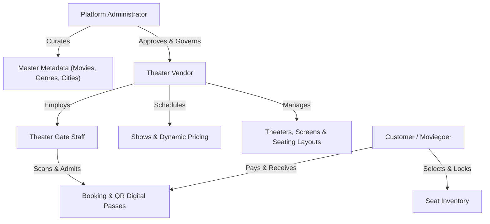
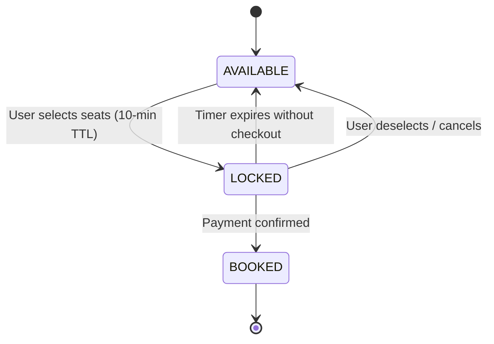

# MovieFixer – Business Rules & Domain Logic Blueprint

> **File:** `PROJECT_MASTER_PLAN_BUSINES_RULE.md`  
> **Target Audience:** Product Managers, Operations Teams, Backend Engineers, QA Engineers  
> **Living Document:** Single source of business truth detailing platform policies, constraints, user workflows, financial rules, and lifecycle state machines.

---

## 1. Stakeholder Personas & Operating Boundaries



### 1.1 Customer (Moviegoer)
- **Primary Goal**: Discover movies in their preferred city, view schedules, select seats, make payments, and access digital passes.
- **Access Boundary**: Can only view public catalogs and manage their own profile, bookings, addresses, and tickets.
- **Constraints**: Maximum of **10 seats per booking** to prevent scalping. Must complete checkout within a **10-minute temporary seat-lock window**.

### 1.2 Theater Vendor
- **Primary Goal**: Manage cinema properties, screens, auditorium seating layouts, show schedules, and monitor local box office earnings.
- **Access Boundary**: Strict data isolation. A vendor can **only view and mutate screens, shows, and revenue belonging to their assigned theaters**. Cross-vendor access is strictly prohibited at the service layer.
- **Constraints**: Shows must respect minimum turnaround times (30 mins between consecutive screenings). Pricing must respect minimum base ticket price thresholds.

### 1.3 Theater Gate Staff
- **Primary Goal**: Scan and validate digital ticket QR passes at cinema auditorium entry gates.
- **Access Boundary**: Read-only validation access to ticket QR tokens for their assigned theater on the date of the show.
- **Constraints**: Cannot alter prices, cancel shows, or view customer payment records.

### 1.4 Platform Administrator
- **Primary Goal**: Maintain marketplace integrity, approve theater vendor onboarding, curate global movie metadata, and monitor platform-wide financial settlements.
- **Access Boundary**: Unrestricted platform-wide governance.
- **Constraints**: Cannot modify confirmed customer bookings or override payment transaction ledgers without audit logging.

---

## 2. User Identity & Account Governance Rules

### 2.1 Registration & Uniqueness Invariants
1. **Unique Identifiers**:
   - `username`, `email`, and `mobile` must be globally unique across all accounts.
   - Any registration attempt matching an existing active or pending identifier must immediately reject with **HTTP 409 Conflict**.
2. **Default Role & Status**:
   - Public customer sign-ups (`POST /api/user/register`) are server-enforced to have `USER_ROLE.CUSTOMER` and `AccountStatus.PENDING`.
   - Elevated roles (`ROLE_ADMIN`, `ROLE_THEATER_VENDOR`, `ROLE_GATE_STAFF`) can only be provisioned by an existing Administrator.

### 2.2 Account Lifecycle State Machine
```text
  [Registration] ──► PENDING ──(Email Verification Token)──► ACTIVE
                       │                                       │
                       ▼ (Admin Action)                        ▼ (Admin Action)
                   DISABLED ◄────────────────────────────── SUSPENDED
```
- **PENDING**: User has registered but not yet verified their email. Allowed to log in and browse, but blocked from completing ticket purchases.
- **ACTIVE**: Full customer capabilities unlocked.
- **SUSPENDED**: Temporarily locked due to suspicious activity, payment chargebacks, or policy violations. Blocked from logging in.
- **DISABLED**: Permanently deactivated account. Cannot log in or register with the same email/username.

### 2.3 Email Verification Policies
- **Token Validity**: Verification tokens expire exactly **24 hours** after generation.
- **Single-Use Invariant**: Upon successful verification (`/api/auth/verify`), the token is marked `used = true` and timestamped. Any subsequent verification attempt with the same token is rejected.
- **Resend Limit**: Resending verification tokens is throttled to once every **2 minutes** per account to prevent email abuse.

---

## 3. Movie Catalog & Metadata Governance

### 3.1 Content Rating Standard
Every movie title must be classified under an official regulatory content rating:
- **`U` (Universal)**: Unrestricted public exhibition; suitable for all audiences.
- **`UA_13_PLUS`**: Parental guidance strongly advised for children under 13.
- **`UA_16_PLUS`**: Parental guidance strongly advised for children under 16.
- **`A` (Adults Only)**: Restricted strictly to persons aged 18 years and above. Gate staff must verify government photo ID.
- **`R` (Restricted)**: Under 17 requires accompanying parent or adult guardian.

### 3.2 Movie Lifecycle & Promotion Rules
```text
  [Draft / Announcement] ──► COMING_SOON ──► NOW_SHOWING ──► ARCHIVED
```
1. **`COMING_SOON`**: Movie is announced, metadata is visible, but no active screenings can be booked unless designated for advance booking.
2. **`NOW_SHOWING`**: Actively scheduled in theaters; tickets available for public purchase.
3. **`ARCHIVED`**: Movie run has concluded. Hidden from public active catalog searches.
4. **Soft-Delete Rule**: Movies with past or active show records **must never be physically deleted from the database** (`DELETE` operation sets `status = ARCHIVED`). This preserves referential integrity for historic customer bookings and financial tax audits.

### 3.3 SEO-Friendly Slug Invariants
- Generated automatically from the movie title (e.g., `"Avatar: Fire and Ash"` $\to$ `"avatar-fire-and-ash"`).
- Contains strictly lowercase alphanumeric characters and single hyphens.
- If a slug collision occurs, the platform automatically appends an incremental numerical suffix (`"avatar-fire-and-ash-1"`).

---

## 4. Theaters, Auditoriums & Seating Grid Rules

### 4.1 Theater Properties & Approvals
- A theater belongs to exactly one `City` and is operated by an assigned `THEATER_VENDOR`.
- New theaters submitted by vendors enter a `PENDING_APPROVAL` status and only become publicly visible once verified by a Platform Administrator.

### 4.2 Screens & Projection Formats
- Each theater contains one or more `Screens` / Auditoriums.
- Screens support designated technology formats: `STANDARD_2D`, `IMAX_3D`, `FOUR_DX`, `DOLBY_ATMOS`.
- Modifying screen seat layouts is prohibited if future active shows exist on that screen.

### 4.3 Seating Tiers & Layout Grid
1. **Tier Hierarchy**:
   - **`VIP`**: Recliner seats, highest price tier, typically in rear or center-prime rows.
   - **`PREMIUM`**: Elevated view, wide seating, medium-high price tier.
   - **`EXECUTIVE`**: Standard cinema seats with optimal sightlines.
   - **`STANDARD`**: Front-row or budget seating tier.
2. **Physical Grid Invariants**:
   - Each seat is addressed by a Row Identifier (`A`, `B`, `C`...) and Column Number (`1`, `2`, `3`...).
   - Aisle gaps and empty layout spaces are maintained as coordinates without seat allocations.
   - **Wheelchair Accessibility**: Auditoriums with over 50 seats must designate at least 2 wheelchair-accessible seat locations.

---

## 5. Show Scheduling, Dynamic Pricing & Seat Locking

### 5.1 Scheduling & Turnaround Buffer Rule
- **Turnaround Buffer**: A mandatory buffer of **at least 30 minutes** must exist between the end time of a show and the start time of the next show on the same screen (accounting for cinema cleaning, air cycling, and pre-movie previews).
- **Collision Prevention**: The system strictly prevents scheduling overlapping show intervals on the same screen:
  $$\text{StartTime}_{\text{new}} < \text{EndTime}_{\text{existing}} \quad \text{AND} \quad \text{EndTime}_{\text{new}} > \text{StartTime}_{\text{existing}}$$
- Shows cannot be scheduled in the past.

### 5.2 Dynamic Seat Pricing Calculation
The effective price for a seat during a show is determined dynamically:
$$\text{SeatPrice} = \text{ShowBasePrice} \times \text{TierMultiplier} + \text{SurgeAdjustment}$$
- **Tier Multipliers**:
  - `VIP`: $2.0 \times$ Base
  - `PREMIUM`: $1.5 \times$ Base
  - `EXECUTIVE`: $1.2 \times$ Base
  - `STANDARD`: $1.0 \times$ Base

### 5.3 High-Concurrency Seat Locking Rules


1. **Selection Lock Window**:
   - When a user selects available seats, they are placed into `LOCKED` state for **exactly 10 minutes**.
   - No other user can select or lock these seats during this window.
2. **Automatic Expiration**:
   - If payment is not finalized within 10 minutes, the background lock expiration job automatically transitions the seats back to `AVAILABLE`.
3. **Fairness Cap**:
   - A single user session cannot hold more than **10 locked seats** simultaneously.

---

## 6. Booking Lifecycle & Digital QR Passes

### 6.1 Booking State Transitions
```text
  [Initiated] ──► PENDING_PAYMENT ──► CONFIRMED
                        │                │
                        ▼ (Timeout)      ▼ (User / Theater Action)
                     EXPIRED          CANCELLED
```
1. **`INITIATED` / `PENDING_PAYMENT`**: Customer has locked seats and entered the checkout screen. A unique booking reference (`MF-YYYYMMDD-XXXXXX`) is generated.
2. **`CONFIRMED`**: Payment gateway webhook returns `SUCCESS`. Seats transition to `BOOKED`. Digital QR tickets are generated and dispatched.
3. **`EXPIRED`**: Checkout timer elapsed without payment. Seats released.
4. **`CANCELLED`**: Cancelled either by customer within policy or by theater management.

### 6.2 Digital Ticket & Gate Pass Admission Rules
- Each confirmed seat generates an individual `Ticket` entity linked to the booking.
- **Cryptographic QR Payload**: The QR code encodes a tamper-proof signed payload containing:
  - `booking_id`
  - `ticket_number`
  - `show_id`
  - `screen_id`
  - `seat_row_number`
  - `hmac_signature`
- **Gate Check-in Policy**:
  - Gate staff scans the QR code at admission.
  - The system checks `is_checked_in`. If `false`, it sets `is_checked_in = true` and records `checked_in_at` and `gate_staff_id`.
  - If already scanned, the system sounds an immediate **"ALREADY ADMITTED"** alert displaying the original admission timestamp to prevent ticket duplication/pass sharing.

---

## 7. Cancellation, Refund & Revenue Split Policies

### 7.1 Customer Cancellation Windows & Refund Tiers

| Time Remaining Before Showtime | Refund Percentage | Convenience Fee Refund | Status |
| :--- | :---: | :---: | :--- |
| **> 24 Hours** | **100%** of Ticket Price | ❌ Non-refundable | Instant credit / Original mode |
| **Between 2 and 24 Hours** | **75%** of Ticket Price | ❌ Non-refundable | Instant credit / Original mode |
| **< 2 Hours** | **0%** (No refund) | ❌ Non-refundable | Cancellation prohibited |
| **Show Cancelled by Theater** | **100%** Full Refund |  **100% Refunded** | Automatic batch refund |

### 7.2 Revenue Settlement & Platform Commission
For every confirmed booking:
1. **Convenience Fee**: 100% retained by MovieFixer platform as service revenue.
2. **Ticket Gross Amount**:
   - **Platform Commission**: Configurable percentage (e.g., 5% to 8%) deducted by MovieFixer.
   - **Vendor Net Payout**: Remaining balance (e.g., 92% to 95%) credited to the Theater Vendor's settlement ledger for periodic payout cycles.

---

## 8. Auditability & Compliance Rules

1. **Immutable Financial Records**: Payment transaction records, refund receipts, and completed booking entries can never be modified or deleted. Any corrections require compensating reversal entries.
2. **Access Log Traceability**: Every gate admission and ticket scan is tagged with the authenticated gate staff user UUID and timestamp.
3. **Data Protection & PII Privacy**: User passwords and security salts/peppers are never returned in API payloads, logs, or exception traces.
