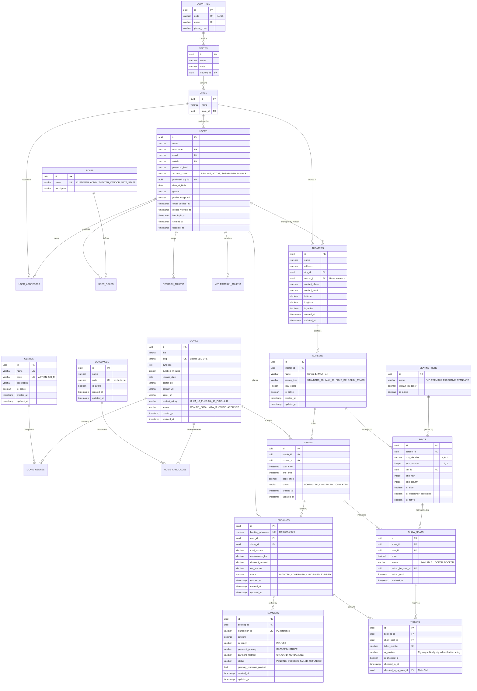

# MovieFixer – Technical Master Plan & Architecture Blueprint

> **File:** `PROJECT_MASTER_PLAN_TECHNICAL_PLAN.md`  
> **Target Audience:** Engineering Leads, Backend Architects, DevOps Engineers  
> **Living Document:** Single source of technical truth for MovieFixer's architecture, database design, APIs, security, and milestones.

---

## 1. Executive Summary & Engineering Principles

**MovieFixer** is a high-throughput, multi-vendor movie ticketing backend built with enterprise patterns. It is designed to handle high-concurrency ticket booking, seat reservation locking, multi-vendor theater management, and real-time inventory management.

### Core Architectural Principles
1. **Feature-Based Architecture (Package-by-Feature)**: Domain features are organized by bounded contexts (`usermanagement`, `auth`, `movie`, `theater`, `show`, `booking`, `payment`, `analytics`) rather than technical layers. Cross-cutting concerns reside strictly in `common`.
2. **Strict UUID Standard**: Every primary key and relational foreign key uses standard 128-bit UUIDs (`UUIDv4`), eliminating sequential enumeration attacks and enabling distributed ID generation.
3. **Third Normal Form (3NF) Database Design**: Strict relational normalization. Master domains (Locations, Roles, Genres, Languages, Seating Tiers) are isolated into dedicated tables with Many-to-Many junction tables to eliminate data redundancy and unnormalized delimited strings.
4. **Dual-Layer Defense Password Architecture**: 
   - Layer 1: Cryptographically random 128-bit dynamic salt generated per-password via BCrypt (work factor 12).
   - Layer 2: Invariant application-level secret "Pepper" mixed prior to BCrypt hashing, sourced exclusively from environment configuration.
5. **Zero-Hardcoding Configuration (SSOT)**: Zero hardcoded URLs, ports, credentials, secrets, or CORS origins in Java code. All configurations are externalized into profile-aware properties (`application-dev.properties`, `application-prod.properties`).
6. **Encapsulation & Non-Leakage (DTO Isolation)**: JPA entity models are never exposed via REST controllers. All requests and responses use strongly validated DTOs wrapped in a uniform [`ApiResponse<T>`](file:///c:/Projects/moviefixer-backend/src/main/java/com/moviebooking/common/dto/ApiResponse.java) envelope.
7. **Native Java 25 POJOs**: Explicit constructors, getters, setters, and SLF4J loggers ensuring complete compatibility with Java 25 compiler optimizations without annotation processor dependencies.

---

## 2. Technology Stack & Framework Specifications

| Tier | Technology | Version | Purpose & Rationale |
| :--- | :--- | :--- | :--- |
| **Language** | Java | **25** | High-performance LTS runtime, pattern matching, virtual threads |
| **Framework** | Spring Boot | **4.0.8** | Modern modular enterprise REST framework |
| **ORM / Persistence** | Spring Data JPA / Hibernate | **7.2.x** | Enterprise relational persistence, automated schema management |
| **Database** | PostgreSQL (Neon Serverless) | **16+** | Cloud-native serverless SQL with native SSL and connection pooling |
| **Connection Pool** | HikariCP | **7.0.2** | High-speed, lightweight JDBC connection pool |
| **Security** | Spring Security | **6.x** | Stateless filter chain, RBAC method security |
| **Token Standard** | JJWT (io.jsonwebtoken) | **0.12.6** | HMAC-SHA256 signed JWT access tokens with rotating refresh tokens |
| **Password Encoder** | Custom `PepperedPasswordEncoder` | Custom | BCrypt (Cost 12) + Application Secret Pepper |
| **Documentation** | Springdoc OpenAPI / Swagger | **3.0** | Interactive API specification at `/swagger-ui/index.html` |
| **Build System** | Maven Wrapper (`mvnw`) | **3.9+** | Hermetic, reproducible compilation and testing |

---

## 3. Feature-Based Package Architecture

The codebase strictly adheres to package-by-feature boundaries under `com.moviebooking`:

```text
com.moviefixer
│
├── MovieFixer.java                              # Spring Boot Application Entry Point
│
├── common/                                      # [CROSS-CUTTING PLATFORM INFRASTRUCTURE]
│   ├── config/                                  # SecurityConfig, PepperedPasswordEncoder, OpenApiConfig, CorsConfig
│   ├── dto/                                     # ApiResponse<T>, ErrorResponse
│   ├── exception/                               # ResourceNotFoundException, GlobalExceptionHandler
│   └── initializer/                             # DatabaseSeeder (Automated master data bootstrapper)
│
├── location/                                    # [DOMAIN: GEOGRAPHIC DATA]
│   ├── entity/                                  # Country, State, City (3NF normalized)
│   ├── repository/                              # CountryRepository, StateRepository, CityRepository
│   ├── dto/                                     # CitySummaryResponse, CountryResponse
│   ├── service/                                 # LocationService, LocationServiceImpl
│   └── controller/                              # LocationController (GET /api/locations/**)
│
├── usermanagement/                              # [DOMAIN: USER IDENTITY & REGISTRATION]
│   ├── entity/                                  # Users, Role, UserAddress
│   ├── enums/                                   # AccountStatus, Gender, USER_ROLE, AddressType
│   ├── repository/                              # UserRepository, RoleRepository, UserAddressRepository
│   ├── dto/                                     # RegisterUserRequest, UserResponse, CreateUserRequest
│   ├── exception/                               # UserAlreadyExistsException (duplicate email/phone/username)
│   ├── service/                                 # UserService, UserServiceImpl
│   └── controller/                              # CreateUserController (/api/user/**)
│
├── auth/                                        # [DOMAIN: AUTHENTICATION & TOKENS]
│   ├── security/                                # JwtTokenProvider, JwtAuthenticationFilter, UserPrincipal, CustomUserDetailsService
│   ├── entity/                                  # RefreshToken, VerificationToken
│   ├── repository/                              # RefreshTokenRepository, VerificationTokenRepository
│   ├── dto/                                     # LoginRequest, RefreshTokenRequest, VerifyEmailRequest, AuthResponse, TokenRefreshResponse
│   ├── service/                                 # AuthService, AuthServiceImpl
│   ├── listener/                                # UserRegistrationEventListener (auto-generates verification token)
│   └── controller/                              # AuthController (/api/auth/**)
│
├── movie/                                       # [DOMAIN: MOVIE CATALOG & METADATA]
│   ├── entity/                                  # Movie, Genre, Language
│   ├── enums/                                   # ContentRating, MovieStatus
│   ├── repository/                              # MovieRepository, GenreRepository, LanguageRepository
│   ├── dto/                                     # CreateMovieRequest, UpdateMovieRequest, MovieResponse, MovieSummaryResponse, GenreRequest, GenreResponse, LanguageRequest, LanguageResponse
│   ├── service/                                 # MovieService, MovieServiceImpl, GenreService, GenreServiceImpl, LanguageService, LanguageServiceImpl
│   └── controller/                              # MovieController, GenreController, LanguageController (/api/movies/**, /api/genres/**, /api/languages/**)
│
├── theater/                                     # [DOMAIN: THEATERS, AUDITORIUMS & SEATING]
│   ├── entity/                                  # Theater, Screen, SeatingTier, Seat
│   ├── enums/                                   # ScreenType, TierType
│   ├── repository/                              # TheaterRepository, ScreenRepository, SeatRepository, SeatingTierRepository
│   ├── dto/                                     # CreateTheaterRequest, ScreenRequest, BatchSeatLayoutRequest, GenerateGridRequest, TheaterResponse, ScreenResponse, ScreenLayoutResponse
│   ├── service/                                 # TheaterService, ScreenService, SeatingTierService, SeatLayoutService
│   └── controller/                              # TheaterController, ScreenController, SeatingTierController (/api/theaters/**, /api/screens/**, /api/seating-tiers/**)
│
├── show/                                        # [DOMAIN: SHOW SCHEDULES & INVENTORY]
│   ├── entity/                                  # Show, ShowSeat
│   ├── enums/                                   # ShowStatus, ShowSeatStatus (AVAILABLE, LOCKED, BOOKED)
│   ├── repository/                              # ShowRepository, ShowSeatRepository
│   ├── dto/                                     # CreateShowRequest, ShowResponse, ShowSeatLayoutResponse, LockSeatRequest
│   ├── service/                                 # ShowService, ShowSeatLockService
│   └── controller/                              # ShowController (/api/shows/**)
│
├── booking/                                     # [DOMAIN: BOOKINGS & QR PASSES]
│   ├── entity/                                  # Booking, Ticket
│   ├── enums/                                   # BookingStatus (PENDING, CONFIRMED, CANCELLED, EXPIRED)
│   ├── repository/                              # BookingRepository, TicketRepository
│   ├── dto/                                     # CreateBookingRequest, BookingResponse, TicketPassResponse
│   ├── service/                                 # BookingService, QrCodeService
│   └── controller/                              # BookingController (/api/bookings/**)
│
├── payment/                                     # [DOMAIN: PAYMENTS & INVOICES]
│   ├── entity/                                  # PaymentTransaction, RefundRecord
│   ├── enums/                                   # PaymentStatus, PaymentMethod, RefundStatus
│   ├── repository/                              # PaymentTransactionRepository, RefundRecordRepository
│   ├── dto/                                     # PaymentInitiateRequest, PaymentCallbackRequest, PaymentResponse
│   ├── service/                                 # PaymentService, WebhookService
│   └── controller/                              # PaymentController (/api/payments/**)
│
└── analytics/                                   # [DOMAIN: REVENUE & OCCUPANCY ANALYTICS]
    ├── dto/                                     # OccupancyRateResponse, TheaterRevenueSummary, PlatformMetricsResponse
    ├── service/                                 # AnalyticsService, AnalyticsServiceImpl
    └── controller/                              # AnalyticsController (/api/analytics/**)
```

---

## 4. Comprehensive 3NF Normalized Database Schema

Every entity employs **UUID Version 7** (`@UuidGenerator(style = UuidGenerator.Style.VERSION_7)` complying with RFC 9562) primary keys and strict foreign key relationships. The 48-bit Unix epoch timestamp prefix guarantees sequential, time-ordered B-Tree index inserts, completely eliminating the B-Tree page splits and cache thrashing associated with random UUIDv4:




---

## 5. Security Architecture & Threat Mitigation

### 5.1 Dual-Layer Password Hashing Strategy
```
User Plaintext Password
          │
          ▼
┌───────────────────────────────┐
│ System Secret Pepper Addition │ <── app.security.password.pepper (Env Secret)
└──────────────┬────────────────┘
               ▼
┌───────────────────────────────┐
│ BCrypt Dynamic Salt (128-bit) │ <── Work Factor: 12 (Randomized per hash)
└──────────────┬────────────────┘
               ▼
Stored Hash in users.password_hash ($2a$12$...)
```

### 5.2 Stateless JWT & Refresh Token Rotation Flow
1. **Access Token**: Short-lived (15 minutes), HMAC-SHA256 signed with `app.jwt.secret`. Contains user UUID, username, email, and granted authority roles.
2. **Refresh Token**: Long-lived (7 days), stored securely in the database (`refresh_tokens` table) as a cryptographically random UUID string.
3. **Replay & Theft Detection**: When a refresh token is exchanged, it is immediately revoked and replaced by a child token. If an already-revoked refresh token is presented, the system detects a token reuse attack and revokes the entire user token family, forcing re-authentication.

### 5.3 Role-Based Access Control (RBAC) Matrix (6 Distinct System Roles)

The platform supports 6 distinct roles defined in `users`: `CUSTOMER`, `THEATER_VENDOR`, `THEATER_MANAGER`, `THEATER_TICKET_STAFF`, `ADMIN_SUPPORT`, and `ADMIN`.

| Resource / Endpoint | HTTP Method | Public | CUSTOMER | THEATER_VENDOR | THEATER_MANAGER | THEATER_TICKET_STAFF | ADMIN_SUPPORT | ADMIN |
| :--- | :---: | :---: | :---: | :---: | :---: | :---: | :---: | :---: |
| `/api/user/register` | `POST` | ✔ | ❌ | ❌ | ❌ | ❌ | ❌ | ❌ |
| `/api/auth/login`, `/refresh`, `/verify` | `POST` / `GET` | ✔ | ✔ | ✔ | ✔ | ✔ | ✔ | ✔ |
| `/api/user/me` | `GET` | ❌ | ✔ | ✔ | ✔ | ✔ | ✔ | ✔ |
| `/api/user/create` | `POST` | ❌ | ❌ | ❌ | ❌ | ❌ | ❌ | ✔ |
| `/api/locations/**` | `GET` | ✔ | ✔ | ✔ | ✔ | ✔ | ✔ | ✔ |
| `/api/movies/**`, `/api/genres/**`, `/api/languages/**` | `GET` | ✔ | ✔ | ✔ | ✔ | ✔ | ✔ | ✔ |
| `/api/movies` (Create / Update) | `POST` / `PUT` | ❌ | ❌ | ✔ | ❌ | ❌ | ❌ | ✔ |
| `/api/movies/{id}` (Archive) | `DELETE` | ❌ | ❌ | ❌ | ❌ | ❌ | ❌ | ✔ |
| `/api/genres`, `/api/languages` | `POST` / `PUT` | ❌ | ❌ | ❌ | ❌ | ❌ | ❌ | ✔ |
| `/api/theaters` (Browsing by city) | `GET` | ✔ | ✔ | ✔ | ✔ | ✔ | ✔ | ✔ |
| `/api/theaters`, `/api/theaters/{id}` | `POST` / `PUT` / `DELETE` | ❌ | ❌ | ✔ (Own only) | ❌ | ❌ | ❌ | ✔ |
| `/api/theaters/{id}/screens`, `/api/screens/{id}` | `POST` / `PUT` / `DELETE` | ❌ | ❌ | ✔ (Own only) | ❌ | ❌ | ❌ | ✔ |
| `/api/screens/{id}/layout` | `GET` | ✔ | ✔ | ✔ | ✔ | ✔ | ✔ | ✔ |
| `/api/screens/{id}/layout` | `POST` | ❌ | ❌ | ✔ (Own only) | ❌ | ❌ | ❌ | ✔ |
| `/api/seats/{id}/toggle-active` | `PATCH` | ❌ | ❌ | ✔ (Own only) | ❌ | ❌ | ❌ | ✔ |
| `/api/seating-tiers` | `GET` | ✔ | ✔ | ✔ | ✔ | ✔ | ✔ | ✔ |
| `/api/shows/movie/{id}` (BookMyShow Discovery) | `GET` | ✔ | ✔ | ✔ | ✔ | ✔ | ✔ | ✔ |
| `/api/shows/{id}/seats` (Interactive Layout) | `GET` | ✔ | ✔ | ✔ | ✔ | ✔ | ✔ | ✔ |
| `/api/shows`, `/api/shows/batch-daily` | `POST` | ❌ | ❌ | ✔ (Own only) | ✔ (Own only) | ❌ | ❌ | ✔ |
| `/api/shows/{id}` (Cancel Show) | `DELETE` | ❌ | ❌ | ✔ (Own only) | ✔ (Own only) | ❌ | ❌ | ✔ |
| `/api/shows/{id}/lock-seats`, `/unlock-seats` | `POST` | ❌ | ✔ | ✔ | ✔ | ✔ | ✔ | ✔ |
| `/api/bookings` (Initiate Session) | `POST` | ❌ | ✔ | ✔ | ✔ | ✔ | ✔ | ✔ |
| `/api/bookings/{id}/confirm` | `POST` | ❌ | ✔ | ✔ | ✔ | ✔ | ✔ | ✔ |
| `/api/bookings/direct` | `POST` | ❌ | ✔ | ✔ | ✔ | ✔ | ✔ | ✔ |
| `/api/bookings/my-bookings` | `GET` | ❌ | ✔ | ✔ | ✔ | ✔ | ✔ | ✔ |
| `/api/bookings/{id}` | `GET` | ❌ | ✔ (Own) | ✔ (Own) | ✔ (Own) | ❌ | ✔ | ✔ |
| `/api/bookings/{id}/cancel` | `POST` | ❌ | ✔ (Own) | ❌ | ❌ | ❌ | ✔ | ✔ |
| `/api/tickets/{ticketNumber}` | `GET` | ❌ | ✔ (Own) | ✔ (Own) | ✔ (Own) | ✔ | ✔ | ✔ |
| `/api/tickets/validate-qr` (Gate Scan) | `POST` | ❌ | ❌ | ✔ | ✔ | ✔ | ❌ | ✔ |
| `/api/analytics/platform/**` | `GET` | ❌ | ❌ | ❌ | ❌ | ❌ | ❌ | ✔ |
| `/api/analytics/vendor/**` | `GET` | ❌ | ❌ | ✔ (Own only) | ❌ | ❌ | ❌ | ✔ |
| `/api/analytics/shows/{showId}` | `GET` | ❌ | ❌ | ✔ (Own only) | ✔ (Own only) | ❌ | ❌ | ✔ |

---

## 6. High-Throughput & Concurrency Engineering (Zero DB Locking via Query Versioning)

### 6.1 Non-Blocking Optimistic Concurrency Control (OCC)
To eliminate database lock contention, row-level blocking (`SELECT ... FOR UPDATE`), and thread starvation under extreme high-traffic surges, MovieFixer utilizes **Query Versioning and Atomic Compare-And-Swap (CAS)** on the inventory layer:

```text
User A & User B concurrently view Seat B4 (version = 0, status = 'AVAILABLE')
                         │
        ┌────────────────┴────────────────┐
        ▼                                 ▼
User A submits lock first         User B submits lock slightly later
        │                                 │
        ▼                                 ▼
[Atomic Version CAS Query]        [Atomic Version CAS Query]
UPDATE show_seats                 UPDATE show_seats
SET status = 'LOCKED',            SET status = 'LOCKED',
    version = version + 1             version = version + 1
WHERE id = :id                    WHERE id = :id
  AND version = 0                   AND version = 0  <-- (DB row is now version 1!)
  AND status = 'AVAILABLE'          AND status = 'AVAILABLE'
        │                                 │
        ▼                                 ▼
Rows Updated: 1 (SUCCESS)         Rows Updated: 0 (VERSION CONFLICT DETECTED)
User A gets 10-minute hold        User B receives instant rejection:
                                  "Seat B4 was modified by another customer"
```

### 6.2 Architectural Benefits of Query Versioning
1. **Zero DB Row-Level Blocking**: Database connections never sleep or wait on table/row locks. Read operations (`SELECT`) and write operations run entirely unblocked.
2. **Lightning-Fast Execution**: The atomic update executes in $< 1\text{ms}$ at the storage engine level.
3. **Automatic Conflict Rejection**: If another customer booked or reserved the seat between the fetch and submit steps, the version in the `WHERE` clause fails to match, resulting in 0 rows updated and immediate safe failure.
4. **TTL Expiration Cleanup**: Background task (`@Scheduled`) cleans expired holds (`status = 'LOCKED' AND locked_until < NOW()`) and restores status to `AVAILABLE`.

---

## 7. Configuration & Zero-Hardcoding Architecture

All operational properties are managed via profile segregation:
- `application.properties`: Shared base profile (`spring.profiles.active=dev`).
- `application-dev.properties`: Development environment config with local frontend URLs and sandbox settings.
- `application-prod.properties`: Production environment config referencing strictly environment variables (`${DB_URL}`, `${JWT_SECRET}`, `${PEPPER_SECRET}`).

---

## 8. Milestone Implementation Roadmap

| Milestone | Scope | Technical Deliverables | Status |
| :---: | :--- | :--- | :---: |
| **M1** | User Management & Locations | Geographic entities (`Country`, `State`, `City`), `Users`, `Role`, `UserAddress`, Registration API, `ApiResponse<T>`, `GlobalExceptionHandler` | **COMPLETED** |
| **M2** | Authentication & Security | JJWT 0.12 provider, `JwtAuthenticationFilter`, `PepperedPasswordEncoder` (BCrypt + Pepper), Refresh token rotation, email verification event pipeline | **COMPLETED** |
| **M3** | Movie Catalog Management | 3NF normalized `Movie`, `Genre`, `Language`, junction tables, SEO slug generator, multi-criteria catalog search, soft archiving, comprehensive unit test suite | **COMPLETED** |
| **M4** | Theaters, Screens & Seating | Multi-vendor `Theater`, `Screen`, `SeatingTier` (`VIP`, `PREMIUM`, `EXECUTIVE`, `STANDARD`), dynamic 2D `Seat` grid, batch & auto layout generators, tenant authorization | **COMPLETED** |
| **M5** | Shows & Real-time Seat Locking | Show scheduling, collision avoidance algorithm, multi-show batch daily automation (5-6 shows/day), `ShowSeat` inventory, OCC query versioning, TTL cleanup worker | **COMPLETED** |
| **M6** | Booking Engine & Digital Passes | Zero DB row locking with query versioning CAS, cryptographic HMAC-SHA256 QR passes, duplicate scan gate check-in, policy cancellations, automated reaper | **COMPLETED** |
| **M7** | Payments & Settlements | Payment gateway integration (Razorpay/Stripe webhook verification), idempotency keys, refund processing | **NEXT** |
| **M8** | Analytics & Multi-Vendor Dashboards | Aggregated queries for occupancy rates, gross box office collections, vendor revenue settlement ledger, executive metrics, daily trend analysis | **COMPLETED** |

