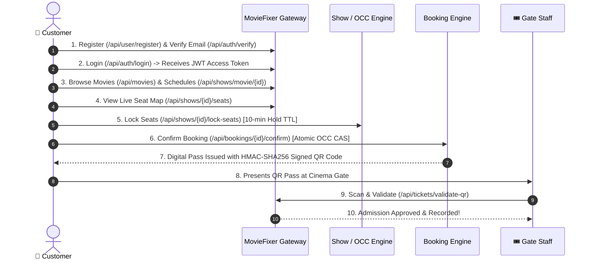
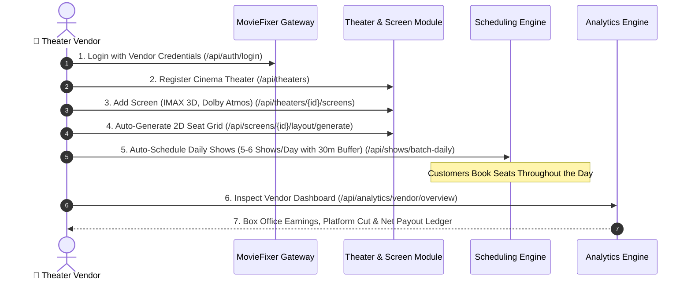

# MovieFixer – User Roles & Permissions Guide (User Type Documentation)

> **File:** `USER_TYPE_DOCUMENTATION.md`  
> **Target Audience:** Frontend Developers, Backend Engineers, Product Managers, QA, Operations & Support  
> **Purpose:** Detailed operational and security blueprint for each of the **6 user types** in the MovieFixer platform, detailing onboarding, privileges, restrictions, API access, and workflow journeys.

---

## 1. System Role Hierarchy & Classification

MovieFixer defines **6 first-class roles** in `com.moviefixer.users.enums.USER_ROLE`:

```
                           ┌───────────────────────────┐
                           │      MovieFixer Roles     │
                           └─────────────┬─────────────┘
                                         │
        ┌────────────────────────────────┼────────────────────────────────┐
        ▼                                ▼                                ▼
 ┌───────────────┐              ┌──────────────────┐             ┌─────────────────┐
 │   CUSTOMER    │              │  THEATER DOMAIN  │             │  ADMIN DOMAIN   │
 │  (Moviegoer)  │              └────────┬─────────┘             └────────┬────────┘
 └───────────────┘                       │                                │
                       ┌─────────────────┼────────────────┐      ┌────────┴────────┐
                       ▼                 ▼                ▼      ▼                 ▼
                [THEATER_VENDOR] [THEATER_MANAGER] [THEATER_TICKET_STAFF] [ADMIN] [ADMIN_SUPPORT]
```

### Quick Role Comparison Matrix

| Role | Domain | Onboarding Method | Primary Scope | Multi-Tenant Isolated? |
| :--- | :---: | :---: | :--- | :---: |
| **`CUSTOMER`** | Consumer | Self-Registration (`/api/user/register`) | Browsing, seat hold, booking, QR passes | Yes (Own data only) |
| **`THEATER_VENDOR`** | Partner | Admin Provisioned (`/api/user/create`) | Cinema ownership, screens, 2D grids, shows, box office | **Yes (Own cinemas only)** |
| **`THEATER_MANAGER`** | Operations | Admin Provisioned (`/api/user/create`) | Day-to-day show scheduling, occupancy yield, gate ops | **Yes (Assigned cinema)** |
| **`THEATER_TICKET_STAFF`**| Gate | Admin Provisioned (`/api/user/create`) | Gate pass scanning, HMAC QR check, admission alerts | **Yes (Gate admission)** |
| **`ADMIN`** | Platform | Seeded / Admin Provisioned | Global catalog, user accounts, platform GMV analytics | No (Platform-wide) |
| **`ADMIN_SUPPORT`** | Helpdesk | Admin Provisioned (`/api/user/create`) | Customer ticket lookup, cancellation assistance | No (Support read/assist) |

---

## 2. Detailed User Type Breakdown

---

### Type 1: `CUSTOMER` (`ROLE_CUSTOMER`)

#### 1.1 Persona Overview
The end-user moviegoer who interacts with the client application (Web / iOS / Android) to discover movies, check cinema showtimes in their city, reserve seats on an interactive seat map, and receive digital passes.

#### 1.2 Onboarding & Lifecycle
- **Onboarding**: Public self-registration via `POST /api/user/register`.
- **Initial Status**: `AccountStatus.PENDING`.
- **Activation**: Clicks the verification link sent to their email (`GET /api/auth/verify?token=...`) or posts the token (`POST /api/auth/verify`). Transitions to `AccountStatus.ACTIVE`.
- **Suspension**: Can be set to `SUSPENDED` by an Administrator in case of fraudulent payment chargebacks.

#### 1.3 Key Permissions (What They CAN Do)
- Browse countries, states, and metro cities.
- Browse movies by release status (`NOW_SHOWING`, `COMING_SOON`), genres, languages, and keywords.
- Discover cinema schedules for any movie in their preferred city (BookMyShow-style view).
- View live interactive seating layouts with real-time seat availability and prices.
- Lock up to 10 seats simultaneously for a **10-minute hold window** (`POST /api/shows/{id}/lock-seats`).
- Release holds voluntarily (`POST /api/shows/{id}/unlock-seats`).
- Initiate checkout sessions (`POST /api/bookings`) and confirm bookings with zero DB row locking (`POST /api/bookings/{id}/confirm`).
- Perform 1-step direct bookings (`POST /api/bookings/direct`).
- View personal booking history (`GET /api/bookings/my-bookings`) and download digital QR passes.
- Cancel bookings within allowable cancellation windows (>24 hours: 100% refund, 2–24 hours: 75% refund).
- Update and manage their personal profile (`GET /api/user/me`).

#### 1.4 Security Boundaries (What They CANNOT Do)
- Cannot access or view another customer's booking records.
- Cannot mutate cinema screens, seating layouts, show schedules, or movie catalog entries.
- Cannot hold more than 10 seats concurrently (anti-scalping enforcement).
- Cannot scan tickets at cinema gates.

#### 1.5 Complete Customer API Catalog

| Action | HTTP Method | Endpoint | Security |
| :--- | :---: | :--- | :--- |
| Self-Registration | `POST` | `/api/user/register` | Public |
| Email Verification | `POST` / `GET` | `/api/auth/verify` | Public |
| User Login | `POST` | `/api/auth/login` | Public |
| Refresh Access Token | `POST` | `/api/auth/refresh` | Public |
| User Logout | `POST` | `/api/auth/logout` | Authenticated |
| My Profile | `GET` | `/api/user/me` | Authenticated (`ROLE_CUSTOMER`) |
| Browse Cities | `GET` | `/api/locations/cities` | Public |
| Browse Movies | `GET` | `/api/movies` | Public |
| Movie Showtime Schedule | `GET` | `/api/shows/movie/{movieId}?cityId={cityId}` | Public |
| Live Interactive Seat Map | `GET` | `/api/shows/{showId}/seats` | Public |
| Lock Seats (10-min Hold) | `POST` | `/api/shows/{showId}/lock-seats` | Authenticated (`ROLE_CUSTOMER`) |
| Unlock Seats | `POST` | `/api/shows/{showId}/unlock-seats` | Authenticated (`ROLE_CUSTOMER`) |
| Initiate Booking Checkout | `POST` | `/api/bookings` | Authenticated (`ROLE_CUSTOMER`) |
| Confirm Booking & Get QR | `POST` | `/api/bookings/{bookingId}/confirm` | Authenticated (`ROLE_CUSTOMER`) |
| Direct 1-Step Booking | `POST` | `/api/bookings/direct` | Authenticated (`ROLE_CUSTOMER`) |
| My Bookings List | `GET` | `/api/bookings/my-bookings` | Authenticated (`ROLE_CUSTOMER`) |
| View Specific Booking | `GET` | `/api/bookings/{bookingId}` | Authenticated (Own record only) |
| Cancel Booking | `POST` | `/api/bookings/{bookingId}/cancel` | Authenticated (Own record only) |

---

### Type 2: `THEATER_VENDOR` (`ROLE_THEATER_VENDOR`)

#### 2.1 Persona Overview
The commercial cinema partner or theater chain owner (e.g., PVR, INOX, Cinepolis, or independent cinema operators) who manages physical theaters, screens, seating tier pricing, and schedules movie shows.

#### 2.2 Onboarding & Lifecycle
- **Onboarding**: Provisioned exclusively by a Platform Administrator via `POST /api/user/create` with `roles: ["THEATER_VENDOR"]`.
- **Status**: Activated immediately upon creation (`AccountStatus.ACTIVE`).
- **Data Association**: Each `Theater` entity contains a `vendor_id` foreign key referencing the vendor's user UUID.

#### 2.3 Key Permissions (What They CAN Do)
- Onboard and manage cinema properties (`POST /api/theaters`, `PUT /api/theaters/{id}`, `DELETE /api/theaters/{id}`).
- Configure screens/auditoriums with formats: `STANDARD_2D`, `IMAX_3D`, `FOUR_DX`, `DOLBY_ATMOS`.
- Generate custom 2D seating grids (`POST /api/screens/{id}/layout`).
- Auto-generate NxM standard seating grids (`POST /api/screens/{id}/layout/generate`).
- Toggle individual seat maintenance/broken status (`PATCH /api/seats/{id}/toggle-active`).
- Schedule individual movie shows (`POST /api/shows`).
- Auto-schedule daily multi-slot shows (5 to 6 shows/day) with mandatory 30-minute cleaning turnaround buffers (`POST /api/shows/batch-daily`).
- Cancel scheduled shows before bookings take place (`DELETE /api/shows/{id}`).
- Access **Vendor Box Office Dashboard** (`GET /api/analytics/vendor/overview`):
  - Gross Box Office Revenue
  - Platform Convenience Commission Deducted
  - Net Vendor Payout Ledger
  - Gate Check-in Admission Rates
- Inspect theater-level performance breakdown (`GET /api/analytics/vendor/theaters`).
- Rank movie earnings across their properties (`GET /api/analytics/vendor/movies`).
- View real-time show capacity utilization and tier breakdown (`GET /api/analytics/shows/{showId}`).

#### 2.4 Multi-Tenant Data Isolation (What They CANNOT Do)
- **Strict Data Isolation**: A vendor **CANNOT** view, edit, or delete theaters, screens, shows, or revenue belonging to another vendor. Service layers enforce:
  $$\text{currentUser.id} == \text{theater.vendor.id}$$
- Cannot view platform-wide executive metrics (GMV across all vendors).
- Cannot manage platform master tables (Genres, Languages, Cities).

#### 2.5 Vendor API Catalog

| Action | HTTP Method | Endpoint | Scope |
| :--- | :---: | :--- | :--- |
| Create Theater | `POST` | `/api/theaters` | Vendor Owner |
| Update Theater | `PUT` | `/api/theaters/{id}` | Own Theater Only |
| Delete/Archive Theater | `DELETE` | `/api/theaters/{id}` | Own Theater Only |
| List My Theaters | `GET` | `/api/theaters/vendor/{vendorId}` | Own Vendor ID Only |
| Create Screen | `POST` | `/api/theaters/{theaterId}/screens` | Own Theater Only |
| Update Screen | `PUT` | `/api/screens/{screenId}` | Own Theater Only |
| Configure Seating Grid | `POST` | `/api/screens/{screenId}/layout` | Own Screen Only |
| Auto-Generate Grid | `POST` | `/api/screens/{screenId}/layout/generate` | Own Screen Only |
| Toggle Seat Active | `PATCH` | `/api/seats/{seatId}/toggle-active` | Own Screen Only |
| Schedule Single Show | `POST` | `/api/shows` | Own Screen Only |
| Batch Daily Scheduling | `POST` | `/api/shows/batch-daily` | Own Screen Only |
| Cancel Show | `DELETE` | `/api/shows/{id}` | Own Show Only |
| Vendor Overview Dashboard | `GET` | `/api/analytics/vendor/overview` | Own Financials Only |
| Vendor Theater Breakdown | `GET` | `/api/analytics/vendor/theaters` | Own Theaters Only |
| Vendor Movie Performance | `GET` | `/api/analytics/vendor/movies` | Own Theaters Only |
| Show Occupancy Analytics | `GET` | `/api/analytics/shows/{showId}` | Own Show Only |

---

### Type 3: `THEATER_MANAGER` (`ROLE_THEATER_MANAGER`)

#### 3.1 Persona Overview
The on-site operational manager at a physical cinema location responsible for day-to-day showtime logistics, seating capacity monitoring, and coordinating gate staff.

#### 3.2 Onboarding & Lifecycle
- **Onboarding**: Provisioned by Platform Administrator or Cinema Vendor via `POST /api/user/create` with `roles: ["THEATER_MANAGER"]`.
- **Status**: `AccountStatus.ACTIVE`.

#### 3.3 Key Permissions (What They CAN Do)
- Create and manage daily show schedules and batch multi-slot schedules (`POST /api/shows`, `POST /api/shows/batch-daily`).
- Cancel shows in case of emergency equipment failure (`DELETE /api/shows/{id}`).
- Monitor real-time seat inventory, occupancy rates, and tier-wise capacity yield (`GET /api/analytics/shows/{showId}`).
- Gate admission scanning privileges (`POST /api/tickets/validate-qr`).
- Inspect ticket records by ticket number (`GET /api/tickets/{ticketNumber}`).

#### 3.4 Security Boundaries (What They CANNOT Do)
- Cannot delete or restructure physical auditoriums/screens or modify master seating tiers.
- Cannot access vendor-level payout settlement ledgers or bank account configurations.
- Cannot modify platform movie metadata.

---

### Type 4: `THEATER_TICKET_STAFF` (`ROLE_THEATER_TICKET_STAFF`)

#### 4.1 Persona Overview
The auditorium gate usher or ticket scanner stationed at the cinema entrance who scans customer digital passes prior to hall admission.

#### 4.2 Onboarding & Lifecycle
- **Onboarding**: Provisioned by Platform Administrator via `POST /api/user/create` with `roles: ["THEATER_TICKET_STAFF"]`.
- **Status**: `AccountStatus.ACTIVE`.

#### 4.3 Key Permissions (What They CAN Do)
- Scan customer digital QR passes at cinema entrance (`POST /api/tickets/validate-qr`).
- Receive real-time validation feedback:
  - **Success (`ADMITTED`)**: Valid pass, signature verified, admission timestamped.
  - **Duplicate Alert (`ALREADY_CHECKED_IN`)**: Triggers an alert showing original entry time to prevent ticket sharing/re-entry.
  - **Invalid Pass**: Reject forged or expired passes.
- Lookup ticket details by ticket number (`GET /api/tickets/{ticketNumber}`).

#### 4.4 Security Boundaries (What They CANNOT Do)
- **Strictly Validation Access**: Cannot create or cancel shows, adjust ticket pricing, or issue customer refunds.
- Cannot access customer billing or payment details.

#### 4.5 Gate Staff QR Scan API Example

**Request (`POST /api/tickets/validate-qr`)**:
```json
{
  "qrPayload": "eyJib29raW5nSWQiOiIwMTk0ODNhMi00ZjMyLTcwMDAiLCJ0aWNrZXROdW1iZXIiOiJUS1QtMjAyNjEwMTAtMDAxIn0=.a8f9c2e..."
}
```

**Success Response (`HTTP 200 OK`)**:
```json
{
  "success": true,
  "message": "Ticket validated successfully. Admitted to Screen 1.",
  "data": {
    "ticketNumber": "TKT-20261010-001",
    "movieTitle": "Interstellar",
    "screenName": "Screen 1 - IMAX 3D",
    "seatIdentifier": "F12",
    "tierName": "VIP",
    "showStartTime": "2026-10-10T18:30:00",
    "checkedIn": true,
    "checkedInAt": "2026-10-10T18:15:22"
  }
}
```

**Duplicate Scan Alert Response (`HTTP 409 Conflict`)**:
```json
{
  "success": false,
  "message": "SECURITY ALERT: Ticket TKT-20261010-001 was already scanned at 2026-10-10T18:15:22 by Staff John. Entry denied.",
  "errorCode": "DUPLICATE_ADMISSION"
}
```

---

### Type 5: `ADMIN` (`ROLE_ADMIN`)

#### 5.1 Persona Overview
The platform superuser and executive administrator who oversees marketplace integrity, commercial vendor onboarding, global movie metadata, and platform-wide revenue.

#### 5.2 Onboarding & Lifecycle
- **Onboarding**: Seeded automatically during initial system deployment by [`DatabaseSeeder.java`](file:///c:/Projects/moviefixer-backend/src/main/java/com/moviefixer/common/initializer/DatabaseSeeder.java) or created by an existing Admin.
- **Status**: `AccountStatus.ACTIVE`.

#### 5.3 Key Permissions (What They CAN Do)
- Provision new accounts with custom roles (`POST /api/user/create`).
- Full CRUD over global movie catalog (`POST /api/movies`, `PUT /api/movies/{id}`, `DELETE /api/movies/{id}`).
- Curate master genres (`POST /api/genres`) and languages (`POST /api/languages`).
- Access **Platform Executive Analytics** (`/api/analytics/platform/**`):
  - Gross Merchandise Value (GMV)
  - Platform Convenience Fee Net Revenue
  - Total Vendor Payout Balance
  - Total Completed vs Cancelled Bookings
  - Top 10 Grossing Movies Platform-Wide
  - Regional City Box Office Performance
  - 30-Day Daily Revenue Time-Series Trends
- Global override access to all theater layouts, shows, and booking records.

#### 5.4 Security Boundaries & Governance
- Bound by audit trails: cannot alter historical financial transaction records or change confirmed customer payments without ledger reversals.

---

### Type 6: `ADMIN_SUPPORT` (`ROLE_ADMIN_SUPPORT`)

#### 5.1 Persona Overview
The customer support agent or helpdesk representative who assists customers with booking issues, inquiries, ticket lookups, and policy-compliant cancellations.

#### 5.2 Onboarding & Lifecycle
- **Onboarding**: Created by an Administrator via `POST /api/user/create` with `roles: ["ADMIN_SUPPORT"]`.
- **Status**: `AccountStatus.ACTIVE`.

#### 5.3 Key Permissions (What They CAN Do)
- Search and view booking records by booking reference or UUID (`GET /api/bookings/{id}`).
- Inspect ticket status and check-in history (`GET /api/tickets/{ticketNumber}`).
- Process assisted customer cancellations with automated refund calculation (`POST /api/bookings/{id}/cancel`).
- Resend account verification emails for pending customers (`POST /api/auth/resend-verification`).

#### 5.4 Security Boundaries (What They CANNOT Do)
- Cannot delete movies, modify theater seating grids, or change show schedules.
- Cannot view platform executive GMV analytics or vendor payout ledgers.

---

## 3. End-to-End User Journey Walkthroughs

### 3.1 Customer Booking Journey



---

### 3.2 Vendor Cinema Setup & Box Office Journey



---

## 4. Implementation Reference Guide

| Component | Java Package | Primary Class |
| :--- | :--- | :--- |
| Role Enum | `com.moviefixer.users.enums` | [`USER_ROLE.java`](file:///c:/Projects/moviefixer-backend/src/main/java/com/moviefixer/users/enums/USER_ROLE.java) |
| Security Context Principal | `com.moviefixer.auth.security` | [`UserPrincipal.java`](file:///c:/Projects/moviefixer-backend/src/main/java/com/moviefixer/auth/security/UserPrincipal.java) |
| Security Filter Chain | `com.moviefixer.common.config` | [`SecurityConfig.java`](file:///c:/Projects/moviefixer-backend/src/main/java/com/moviefixer/common/config/SecurityConfig.java) |
| User Service | `com.moviefixer.users.service` | [`UserServiceImpl.java`](file:///c:/Projects/moviefixer-backend/src/main/java/com/moviefixer/users/service/UserServiceImpl.java) |
| Authentication Service | `com.moviefixer.auth.service` | [`AuthServiceImpl.java`](file:///c:/Projects/moviefixer-backend/src/main/java/com/moviefixer/auth/service/AuthServiceImpl.java) |
| Gate Admission Service | `com.moviefixer.booking.service` | [`TicketValidationServiceImpl.java`](file:///c:/Projects/moviefixer-backend/src/main/java/com/moviefixer/booking/service/TicketValidationServiceImpl.java) |
| Analytics Aggregation | `com.moviefixer.analytics.service`| [`AnalyticsServiceImpl.java`](file:///c:/Projects/moviefixer-backend/src/main/java/com/moviefixer/analytics/service/AnalyticsServiceImpl.java) |
